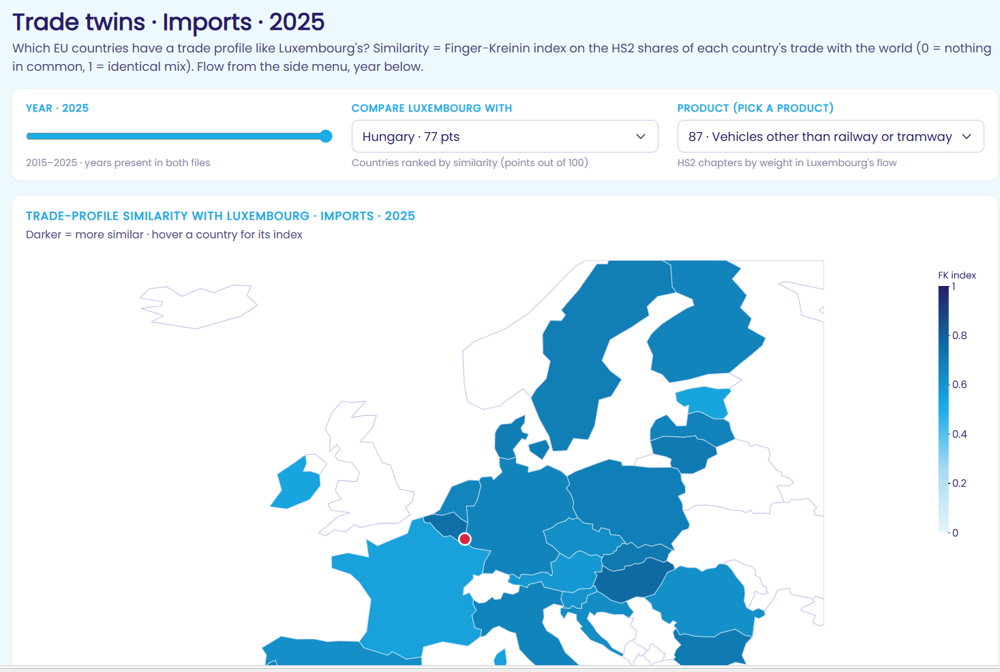

# Trade Cockpit · Luxembourg

**Interactive dashboard of Luxembourg's external trade in goods** — who Luxembourg trades with, what it buys and sells, how this changes over time, and which EU countries have a similar trade profile.

Built for the **STATEC Hackathon 2026** (14–16 October 2026, GovTech Lab Luxembourg), challenge *"Luxembourg's external trade data"*, by team **Dat'Artemis**.

One R Markdown file produces one self-contained HTML page. No server, no database: open the HTML in a browser and everything works offline (except the fonts and the map background).

🇫🇷 *Version française plus bas : [Lire en français](#trade-cockpit--luxembourg-fr)*



---

## Contents

1. [What the cockpit shows](#1-what-the-cockpit-shows)
2. [Quick start](#2-quick-start)
3. [Repository structure](#3-repository-structure)
4. [Data](#4-data)
5. [How the page works](#5-how-the-page-works)
6. [Methods, in plain words](#6-methods-in-plain-words)
7. [Reuse: another year, another country](#7-reuse-another-year-another-country)
8. [Known limits](#8-known-limits)
9. [Team](#9-team)
10. [Licence](#10-licence)

---

## 1. What the cockpit shows

The page has five views, selected in the left menu. Every view can be switched between **imports** and **exports**.

| View | What you see | Challenge question it answers |
|---|---|---|
| **Summary** | Key figures of the year, top 5 product families imported and exported, trade balance over time and by product, "dependence" charts (big, concentrated and unbalanced flows), the four neighbours (BE, FR, NL, DE) and the history of their top 5 products | Main categories of goods · how they changed over time · trade with the neighbours |
| **Overview** | World map of partners (click a country to see its yearly evolution), top 20 partners, trade flows (origins → Luxembourg → destinations), trade balance by partner, partner × product heatmap | Main trading partners · how they evolved over time · partners of a given product |
| **Product** | For each product family: how many partners are needed to reach X % of the flow (slider), cumulative curve, value vs concentration | Partners of a given product · how concentrated the supply is |
| **Country** | One partner (or a region such as EU, Asia…): imports, exports, balance, yearly evolution, main goods bought and sold, product concentration, members of the region | Main goods traded with a given partner |
| **Trade twins** | Which EU countries buy (or sell) the same mix of products as Luxembourg: similarity map, score taken apart product by product, top 5 side by side, "pick a product" | Luxembourg compared with other countries |

The page covers **all years available** (1999 to the latest year in the data). The year shown in the Summary, Overview, Product and Country views is a parameter of the file; the Trade twins view has its own year slider.

---

## 2. Quick start

**You need:** R (≥ 4.2) and RStudio (RStudio brings *pandoc*, which R Markdown needs). The R packages are installed automatically the first time you knit (`tidyverse`, `plotly`, `crosstalk`, `htmltools`, `bslib`, `DT`, `jsonlite`, `readxl`, `knitr`, `rmarkdown`).

```text
1. Clone or download this repository.
2. Put the data files in data/  (see section 4; final_df.rds is the only one that is required).
3. Open trade_cockpit_LU.Rmd in RStudio and press  Knit.
```

Or from the R console, from the root of the repository:

```r
rmarkdown::render("trade_cockpit_LU.Rmd")                                  # year 2025 (default)
rmarkdown::render("trade_cockpit_LU.Rmd", params = list(year = 2019),
                  output_file = "trade_cockpit_LU_2019.html")
```

The result is **one HTML file (about 15 MB)** next to the `.Rmd`. Open it in any modern browser (Chrome, Edge, Firefox). Knitting takes 1–2 minutes.

**No R installed?** Open `output/trade_cockpit_LU.html`: it is the knitted page, ready to use.

---

## 3. Repository structure

```text
Hackathon-2026-Trade/
├── README.md
├── LICENSE                     EUPL-1.2
├── trade_cockpit_LU.Rmd        ALL the code: data preparation, charts, page layout, interactivity
├── data/
│   ├── final_df.rds            Luxembourg × all partner countries (required)
│   ├── eu27_df.rds             the other EU countries × World (Trade twins view; optional)
│   └── code_agg.xlsx           Eurostat list of partner aggregates = the "Regions" (optional)
├── scripts/
│   └── fetch_eu27.R            rebuilds data/eu27_df.rds from the Eurostat API
├── output/
│   └── trade_cockpit_LU.html   the knitted page
└── docs/
    ├── pitch_deck.pdf
    └── screenshots/
```

Everything the page needs is in **one** `.Rmd` file, on purpose: copy the file, add the data, knit. The file is organised in named chunks:

| Chunk | Role |
|---|---|
| `setup` | packages, colours, constants |
| `load-data` | reads `final_df.rds`, keeps the partner countries, builds the tables by product × flow × partner |
| `helpers`, `kpis` | formatting functions, key figures |
| `widgets` | the plotly charts of the Overview, Product and Country views |
| `twins-data` | the Trade twins computations (needs `eu27_df.rds`) |
| `summary` | the Summary view: top 5, balance, dependence, neighbours |
| `cockpit` | the HTML layout: sidebar, tabs, cards |
| `kpi-json` + the final `<script>` | the data stored in the page and the JavaScript that switches the charts when you use the controls |

---

## 4. Data

All data come from **Eurostat Comext**, dataset **[ds-045409] EU trade since 1988 by HS2-4-6 and CN8**, indicator *VALUE_IN_EUROS*, annual frequency. Source: Eurostat, © European Union — free reuse allowed provided the source is acknowledged ([Eurostat copyright notice](https://ec.europa.eu/eurostat/en/help/copyright-notice)).

Products are **HS2 chapters**: the goods are grouped into 97 families following the international customs classification (Harmonized System, 2-digit level): 87 = vehicles, 84 = machinery, 30 = pharmaceuticals, 27 = mineral fuels, and so on. `TOTAL` = all products.

### 4.1 `data/final_df.rds` — required

| | |
|---|---|
| Selection in Comext | reporter = **Luxembourg (LU)** · partner = **all** partner countries and the *World* aggregate · product = `TOTAL` + the 97 HS2 chapters · flow = 1 (import) and 2 (export) · annual, **1999 → latest year** |
| Size | about 262 000 rows |
| Columns used by the page | `PRODUCT_CODE`, `PRODUCT_LABEL`, `FLOW_LABEL` (IMPORT / EXPORT), `PARTNER_CODE`, `PARTNER_LABEL`, `TIME` (year), `VALUE_IN_EUROS` |
| Other columns (ignored) | `FLOW_CODE`, `INDICATOR_CODE` |

How to rebuild it: in the [Eurostat Data Browser](https://ec.europa.eu/eurostat/databrowser/view/ds-045409/default/table), select the dimensions above and download, or query the Comext API (same approach as `scripts/fetch_eu27.R`). Then save the table with `saveRDS(final_df, "data/final_df.rds")`. Column names are those of the Eurostat download (upper case).

### 4.2 `data/eu27_df.rds` — for the Trade twins view

| | |
|---|---|
| Selection | reporter = **each of the other 26 EU countries** · partner = `WORLD` only · product = `TOTAL` + HS2 chapters · both flows · annual, 1999 → latest year |
| Size | about 140 000 rows |
| Columns | the same as `final_df.rds` plus `REPORTER_CODE` |
| How to build it | `Rscript scripts/fetch_eu27.R` (one request per country, cached in `data/eu27_parts/`, a few minutes) |

Without this file the page still knits; the Trade twins view shows a notice instead of the charts.

### 4.3 `data/code_agg.xlsx` — for the "Regions" of the Country view

Eurostat's list of **partner aggregates** (EU27, euro area, Asia, Africa, OPEC…): an Excel sheet with three columns, `code`, `label` and `note`, where `note` lists the member countries of each aggregate (for example `EU27_2020: AT, BE, BG, …`). It comes from the Comext metadata of the *PARTNER* dimension. Without it the page still knits; the Country view offers countries only.

### 4.4 What is dropped on purpose

* Partner codes that are not countries (stores and provisions, confidential trade, "not specified"…) are excluded from the charts. The sidebar lists them under *non-country codes excluded*.
* Chapter 99 (goods not classified elsewhere) is left out of the Summary top 5 and of the Trade twins (parameter `excluded_products`).
* The latest year is usually **incomplete** (data up to the last month published by Eurostat).

---

## 5. How the page works

The whole analysis runs **once, when you knit**. R computes every table for every product × flow (and, for the twins, every year) and stores them in the HTML as JSON. A small JavaScript, written at the end of the `.Rmd`, then **swaps the data of the plotly charts** when you use the menu, the product list, the year slider or click a country on the map. This is why the page is a plain file that works without R, Shiny or a server.

Libraries: [plotly](https://plotly.com/r/) for the charts, [crosstalk](https://rstudio.github.io/crosstalk/) for the link between the map and the "annual evolution" chart, [bslib](https://rstudio.github.io/bslib/) for the Bootstrap 5 theme, [DT](https://rstudio.github.io/DT/) for tables, the [tidyverse](https://www.tidyverse.org/) for the data work.

Only two things are loaded from the internet when the page is opened: the *Poppins* font (Google Fonts) and the world map outlines (plotly CDN). Without internet the page still works, with the default font and without the map backgrounds. To knit a fully offline page, host the topojson files yourself and set `params$topojson_url`.

---

## 6. Methods, in plain words

* **Share of a partner** = value traded with that partner ÷ value traded with all partner countries, for one product and one flow. Shares add up to 100 %.
* **Partners needed** (Product view) = how many partners, taken from the largest, are needed to reach the chosen share of the flow (90 % by default). A small number means the product depends on few countries.
* **HHI** (Herfindahl–Hirschman index) = sum of the squared partner shares. 1 = a single partner; 0.25 = one partner at 50 %, or four equal partners. The higher, the more concentrated.
* **Dependence charts** (Summary view): each product family is placed by its weight in total trade (x), its partner concentration HHI (y) and its net dependence (bubble size: the share of the imports that is not covered by exports of the same products). A product is flagged on three criteria — weight ≥ 2 %, HHI ≥ 0.25, dependence ≥ 50 % — and classed *Critical* (3 flags), *High* (2), *Moderate* (1) or *Low* (0).
* **Trade twins — similarity score** (Finger–Kreinin index). For each product family, take its share in Luxembourg's trade and in the other country's trade, and keep the smaller of the two. Add these shared shares over all families: 0 = nothing in common, 100 = identical mix. A score of 77 means that 77 % of the other country's imports (or exports) follow the same product mix as Luxembourg's. Because the score is a sum, it can be taken apart product by product: that is what the butterfly chart and the heatmap show. *Finger, J.M. & Kreinin, M.E. (1979), "A measure of export similarity and its possible uses", Economic Journal 89.*

---

## 7. Reuse: another year, another country

Everything adjustable is in the `params` block at the top of the `.Rmd`:

| Parameter | Default | Meaning |
|---|---|---|
| `year` | 2025 | year of the Summary, Overview, Product and Country views |
| `reporter`, `reporter_code_twins` | Luxembourg, LU | name and code of the country studied |
| `data_path`, `data_eu`, `agg_path` | the three files of section 4 | where the data are |
| `neighbours` | BE, FR, NL, DE | the "neighbouring countries" block of the Summary |
| `top_n`, `heat_n` | 20, 30 | partners shown in the bar charts and the heatmap |
| `threshold` | 0.9 | default concentration threshold (the slider changes it in the page) |
| `evo_default` | BE | partner selected when the Overview opens |
| `twins_rows`, `twins_countries` | 10, 12 | product families and countries shown in the Trade twins |
| `excluded_products` | 99 | chapters left out of the top 5 and the twins |
| `topojson_url` | "" | your own copy of the map files, for an offline page |

You can set them without editing the file:

```r
rmarkdown::render("trade_cockpit_LU.Rmd",
                  params = list(year = 2023, neighbours = c("BE", "FR", "DE")))
```

**Another country.** Extract `final_df.rds` for that reporter (same Comext selection, another reporter code), set `reporter`, `reporter_code_twins` and `neighbours`, and knit. The code never assumes Luxembourg except through these parameters. `scripts/fetch_eu27.R` takes a list of reporters: remove the new country from it and add LU if you want Luxembourg among the twins.

**A newer year.** Re-run the extraction (new rows only change the data file), set `year`, knit.

---

## 8. Known limits

* The last year in the data is partial until Eurostat publishes December.
* HS2 is the only product level. The Comext dataset also has HS4, HS6 and CN8; the code is written for one level and would need a product hierarchy to drill down.
* The HTML is about 15 MB because all the combinations are stored in it. It opens in a second from disk; sending it by e-mail may need a zip.
* Monthly data (seasonality) are not covered.
* Figures are declared by Luxembourg. The same flow declared by the partner country can differ a little (transport costs, timing, goods routed through a third country).

---

## 9. Team

**Dat'Artemis** — Artemis Information Management, Luxembourg

Quentin Barthel · Quentin Schmidt · Kevin Alati · Sandrine Herbeth · Mathieu Scheffer

Questions and suggestions: open an issue on this repository.

---

## 10. Licence

* **Code**: [European Union Public Licence 1.2](https://joinup.ec.europa.eu/collection/eupl/eupl-text-eupl-12) (SPDX: `EUPL-1.2`), see `LICENSE`.
* **Data**: Eurostat, © European Union, reuse allowed with acknowledgement of the source. The data files in `data/` keep that licence; they are not covered by the EUPL.
* **Third-party libraries**: plotly.js (MIT), Bootstrap (MIT), DataTables (MIT), R packages under their own licences.

---
---

<a id="trade-cockpit--luxembourg-fr"></a>
# Trade Cockpit · Luxembourg (FR)

**Tableau de bord interactif du commerce extérieur de biens du Luxembourg** : avec qui le Luxembourg échange, ce qu'il achète et ce qu'il vend, comment cela évolue dans le temps, et quels pays de l'UE ont un profil commercial proche du sien.

Réalisé pour le **STATEC Hackathon 2026** (14–16 octobre 2026, GovTech Lab Luxembourg), défi *« Luxembourg's external trade data »*, par l'équipe **Dat'Artemis**.

Un seul fichier R Markdown produit une seule page HTML autonome. Pas de serveur, pas de base de données : on ouvre le HTML dans un navigateur et tout fonctionne, même hors ligne (sauf la police et le fond de carte).

---

## Sommaire

1. [Ce que montre le cockpit](#1-ce-que-montre-le-cockpit)
2. [Démarrage rapide](#2-démarrage-rapide)
3. [Structure du dépôt](#3-structure-du-dépôt)
4. [Données](#4-données)
5. [Comment la page fonctionne](#5-comment-la-page-fonctionne)
6. [Les méthodes, en mots simples](#6-les-méthodes-en-mots-simples)
7. [Réutiliser : une autre année, un autre pays](#7-réutiliser--une-autre-année-un-autre-pays)
8. [Limites connues](#8-limites-connues)
9. [Équipe](#9-équipe)
10. [Licence](#10-licence-1)

---

## 1. Ce que montre le cockpit

La page a cinq vues, choisies dans le menu de gauche. Chaque vue se consulte en **imports** ou en **exports**.

| Vue | Ce qu'on y voit | Question du défi à laquelle elle répond |
|---|---|---|
| **Summary** | Chiffres clés de l'année, top 5 des familles de produits importées et exportées, balance commerciale dans le temps et par produit, graphiques de « dépendance » (flux importants, concentrés et déséquilibrés), les quatre voisins (BE, FR, NL, DE) et l'historique de leur top 5 | Principales catégories de biens · leur évolution · le commerce avec les voisins |
| **Overview** | Carte du monde des partenaires (cliquer un pays affiche son évolution annuelle), top 20 des partenaires, flux commerciaux (origines → Luxembourg → destinations), balance par partenaire, carte de chaleur partenaire × produit | Principaux partenaires · leur évolution · partenaires d'un produit donné |
| **Product** | Pour chaque famille de produits : combien de partenaires il faut pour atteindre X % du flux (curseur), courbe cumulée, valeur contre concentration | Partenaires d'un produit · concentration de l'approvisionnement |
| **Country** | Un partenaire (ou une région : UE, Asie…) : imports, exports, balance, évolution annuelle, principaux biens achetés et vendus, concentration par produit, membres de la région | Principaux biens échangés avec un partenaire donné |
| **Trade twins** | Quels pays de l'UE achètent (ou vendent) le même mélange de produits que le Luxembourg : carte de similarité, score décomposé produit par produit, top 5 côte à côte, « choisir un produit » | Le Luxembourg comparé aux autres pays |

La page couvre **toutes les années disponibles** (1999 jusqu'à la dernière année des données). L'année affichée dans Summary, Overview, Product et Country est un paramètre du fichier ; la vue Trade twins a son propre curseur d'année.

---

## 2. Démarrage rapide

**Il faut :** R (≥ 4.2) et RStudio (RStudio fournit *pandoc*, nécessaire à R Markdown). Les packages R s'installent tout seuls au premier knit (`tidyverse`, `plotly`, `crosstalk`, `htmltools`, `bslib`, `DT`, `jsonlite`, `readxl`, `knitr`, `rmarkdown`).

```text
1. Cloner ou télécharger ce dépôt.
2. Placer les fichiers de données dans data/  (voir section 4 ; seul final_df.rds est obligatoire).
3. Ouvrir trade_cockpit_LU.Rmd dans RStudio et cliquer sur  Knit.
```

Ou depuis la console R, à la racine du dépôt :

```r
rmarkdown::render("trade_cockpit_LU.Rmd")                                  # année 2025 (par défaut)
rmarkdown::render("trade_cockpit_LU.Rmd", params = list(year = 2019),
                  output_file = "trade_cockpit_LU_2019.html")
```

Le résultat est **un fichier HTML (environ 15 Mo)** à côté du `.Rmd`. Il s'ouvre dans n'importe quel navigateur récent (Chrome, Edge, Firefox). Le knit prend 1 à 2 minutes.

**Pas de R installé ?** Ouvrir `output/trade_cockpit_LU.html` : c'est la page déjà produite, prête à l'emploi.

---

## 3. Structure du dépôt

```text
Hackathon-2026-Trade/
├── README.md
├── LICENSE                     EUPL-1.2
├── trade_cockpit_LU.Rmd        TOUT le code : préparation des données, graphiques, mise en page, interactivité
├── data/
│   ├── final_df.rds            Luxembourg × tous les pays partenaires (obligatoire)
│   ├── eu27_df.rds             les autres pays de l'UE × Monde (vue Trade twins ; facultatif)
│   └── code_agg.xlsx           liste Eurostat des agrégats de partenaires = les « Regions » (facultatif)
├── scripts/
│   └── fetch_eu27.R            reconstruit data/eu27_df.rds depuis l'API Eurostat
├── output/
│   └── trade_cockpit_LU.html   la page produite
└── docs/
    ├── pitch_deck.pdf
    └── screenshots/
```

Tout ce dont la page a besoin tient dans **un seul** fichier `.Rmd`, volontairement : on copie le fichier, on ajoute les données, on knit. Le fichier est organisé en blocs nommés :

| Bloc | Rôle |
|---|---|
| `setup` | packages, couleurs, constantes |
| `load-data` | lit `final_df.rds`, garde les pays partenaires, construit les tables produit × flux × partenaire |
| `helpers`, `kpis` | fonctions de mise en forme, chiffres clés |
| `widgets` | les graphiques plotly des vues Overview, Product et Country |
| `twins-data` | les calculs des Trade twins (a besoin de `eu27_df.rds`) |
| `summary` | la vue Summary : top 5, balance, dépendance, voisins |
| `cockpit` | la mise en page HTML : menu latéral, onglets, cartes |
| `kpi-json` + le `<script>` final | les données stockées dans la page et le JavaScript qui change les graphiques quand on utilise les commandes |

---

## 4. Données

Toutes les données viennent d'**Eurostat Comext**, jeu de données **[ds-045409] EU trade since 1988 by HS2-4-6 and CN8**, indicateur *VALUE_IN_EUROS*, fréquence annuelle. Source : Eurostat, © Union européenne — réutilisation libre à condition de citer la source ([avis de droit d'auteur Eurostat](https://ec.europa.eu/eurostat/en/help/copyright-notice)).

Les produits sont des **chapitres HS2** : les marchandises sont regroupées en 97 familles selon la nomenclature douanière internationale (Système harmonisé, niveau à 2 chiffres) : 87 = véhicules, 84 = machines, 30 = produits pharmaceutiques, 27 = combustibles minéraux, etc. `TOTAL` = tous les produits.

### 4.1 `data/final_df.rds` — obligatoire

| | |
|---|---|
| Sélection dans Comext | déclarant (reporter) = **Luxembourg (LU)** · partenaire = **tous** les pays partenaires et l'agrégat *World* · produit = `TOTAL` + les 97 chapitres HS2 · flux = 1 (import) et 2 (export) · annuel, **1999 → dernière année** |
| Taille | environ 262 000 lignes |
| Colonnes utilisées par la page | `PRODUCT_CODE`, `PRODUCT_LABEL`, `FLOW_LABEL` (IMPORT / EXPORT), `PARTNER_CODE`, `PARTNER_LABEL`, `TIME` (année), `VALUE_IN_EUROS` |
| Autres colonnes (ignorées) | `FLOW_CODE`, `INDICATOR_CODE` |

Pour le reconstruire : dans le [Data Browser d'Eurostat](https://ec.europa.eu/eurostat/databrowser/view/ds-045409/default/table), sélectionner les dimensions ci-dessus et télécharger, ou interroger l'API Comext (même méthode que `scripts/fetch_eu27.R`). Puis enregistrer la table avec `saveRDS(final_df, "data/final_df.rds")`. Les noms de colonnes sont ceux du téléchargement Eurostat (en majuscules).

### 4.2 `data/eu27_df.rds` — pour la vue Trade twins

| | |
|---|---|
| Sélection | déclarant = **chacun des 26 autres pays de l'UE** · partenaire = `WORLD` seulement · produit = `TOTAL` + chapitres HS2 · les deux flux · annuel, 1999 → dernière année |
| Taille | environ 140 000 lignes |
| Colonnes | les mêmes que `final_df.rds` plus `REPORTER_CODE` |
| Comment le construire | `Rscript scripts/fetch_eu27.R` (une requête par pays, mise en cache dans `data/eu27_parts/`, quelques minutes) |

Sans ce fichier la page se génère quand même ; la vue Trade twins affiche un message à la place des graphiques.

### 4.3 `data/code_agg.xlsx` — pour les « Regions » de la vue Country

La liste Eurostat des **agrégats de partenaires** (UE27, zone euro, Asie, Afrique, OPEP…) : une feuille Excel à trois colonnes, `code`, `label` et `note`, où `note` donne les pays membres de chaque agrégat (par exemple `EU27_2020: AT, BE, BG, …`). Elle vient des métadonnées Comext de la dimension *PARTNER*. Sans ce fichier la page se génère quand même ; la vue Country ne propose que des pays.

### 4.4 Ce qui est écarté volontairement

* Les codes partenaires qui ne sont pas des pays (avitaillement, commerce confidentiel, « non précisé »…) sont exclus des graphiques. Le menu latéral les liste sous *non-country codes excluded*.
* Le chapitre 99 (marchandises non classées ailleurs) est laissé hors du top 5 de la vue Summary et des Trade twins (paramètre `excluded_products`).
* La dernière année est en général **incomplète** (données jusqu'au dernier mois publié par Eurostat).

---

## 5. Comment la page fonctionne

Toute l'analyse tourne **une seule fois, au moment du knit**. R calcule chaque table pour chaque produit × flux (et, pour les twins, chaque année) et les range dans le HTML au format JSON. Un petit JavaScript, écrit à la fin du `.Rmd`, **échange ensuite les données des graphiques plotly** quand on utilise le menu, la liste des produits, le curseur d'année ou quand on clique un pays sur la carte. C'est pour cela que la page est un simple fichier qui fonctionne sans R, sans Shiny et sans serveur.

Bibliothèques : [plotly](https://plotly.com/r/) pour les graphiques, [crosstalk](https://rstudio.github.io/crosstalk/) pour le lien entre la carte et le graphique « évolution annuelle », [bslib](https://rstudio.github.io/bslib/) pour le thème Bootstrap 5, [DT](https://rstudio.github.io/DT/) pour les tableaux, le [tidyverse](https://www.tidyverse.org/) pour le travail sur les données.

Seules deux choses sont chargées depuis internet à l'ouverture de la page : la police *Poppins* (Google Fonts) et les contours de la carte du monde (CDN plotly). Sans internet la page fonctionne quand même, avec la police par défaut et sans fond de carte. Pour une page entièrement hors ligne, hébergez vous-même les fichiers topojson et renseignez `params$topojson_url`.

---

## 6. Les méthodes, en mots simples

* **Part d'un partenaire** = valeur échangée avec ce partenaire ÷ valeur échangée avec tous les pays partenaires, pour un produit et un flux. Les parts font 100 % au total.
* **Partenaires nécessaires** (vue Product) = combien de partenaires, en partant du plus gros, il faut pour atteindre la part du flux choisie (90 % par défaut). Un petit nombre veut dire que le produit dépend de peu de pays.
* **HHI** (indice de Herfindahl-Hirschman) = somme des carrés des parts des partenaires. 1 = un seul partenaire ; 0,25 = un partenaire à 50 %, ou quatre partenaires égaux. Plus il est élevé, plus le flux est concentré.
* **Graphiques de dépendance** (vue Summary) : chaque famille de produits est placée selon son poids dans le commerce total (x), la concentration de ses partenaires HHI (y) et sa dépendance nette (taille de la bulle : la part des imports qui n'est pas couverte par des exports des mêmes produits). Un produit reçoit un drapeau par critère atteint — poids ≥ 2 %, HHI ≥ 0,25, dépendance ≥ 50 % — et est classé *Critical* (3 drapeaux), *High* (2), *Moderate* (1) ou *Low* (0).
* **Trade twins — score de similarité** (indice de Finger-Kreinin). Pour chaque famille de produits, on prend sa part dans le commerce du Luxembourg et dans celui de l'autre pays, et on garde la plus petite des deux. On additionne ces parts communes sur toutes les familles : 0 = rien en commun, 100 = mélange identique. Un score de 77 veut dire que 77 % des imports (ou des exports) de l'autre pays suivent le même mélange de produits que ceux du Luxembourg. Comme le score est une somme, on peut le décomposer produit par produit : c'est ce que montrent le graphique en papillon et la carte de chaleur. *Finger, J.M. & Kreinin, M.E. (1979), « A measure of export similarity and its possible uses », Economic Journal 89.*

---

## 7. Réutiliser : une autre année, un autre pays

Tout ce qui se règle est dans le bloc `params` en tête du `.Rmd` :

| Paramètre | Défaut | Sens |
|---|---|---|
| `year` | 2025 | année des vues Summary, Overview, Product et Country |
| `reporter`, `reporter_code_twins` | Luxembourg, LU | nom et code du pays étudié |
| `data_path`, `data_eu`, `agg_path` | les trois fichiers de la section 4 | où sont les données |
| `neighbours` | BE, FR, NL, DE | le bloc « pays voisins » de la vue Summary |
| `top_n`, `heat_n` | 20, 30 | partenaires affichés dans les barres et la carte de chaleur |
| `threshold` | 0.9 | seuil de concentration par défaut (le curseur le change dans la page) |
| `evo_default` | BE | partenaire sélectionné à l'ouverture de la vue Overview |
| `twins_rows`, `twins_countries` | 10, 12 | familles de produits et pays affichés dans les Trade twins |
| `excluded_products` | 99 | chapitres écartés du top 5 et des twins |
| `topojson_url` | "" | votre propre copie des fichiers de carte, pour une page hors ligne |

On peut les changer sans modifier le fichier :

```r
rmarkdown::render("trade_cockpit_LU.Rmd",
                  params = list(year = 2023, neighbours = c("BE", "FR", "DE")))
```

**Un autre pays.** Extraire `final_df.rds` pour ce déclarant (même sélection Comext, autre code de pays), renseigner `reporter`, `reporter_code_twins` et `neighbours`, et knitter. Le code ne suppose jamais le Luxembourg autrement que par ces paramètres. `scripts/fetch_eu27.R` prend une liste de déclarants : retirez-en le nouveau pays et ajoutez LU si vous voulez le Luxembourg parmi les twins.

**Une année plus récente.** Relancer l'extraction (seul le fichier de données change), régler `year`, knitter.

---

## 8. Limites connues

* La dernière année des données est partielle tant qu'Eurostat n'a pas publié décembre.
* HS2 est le seul niveau de produit. Le jeu Comext contient aussi HS4, HS6 et CN8 ; le code est écrit pour un seul niveau et demanderait une hiérarchie de produits pour descendre dans le détail.
* Le HTML pèse environ 15 Mo parce que toutes les combinaisons y sont stockées. Il s'ouvre en une seconde depuis le disque ; pour l'envoyer par e-mail, un zip peut être nécessaire.
* Les données mensuelles (saisonnalité) ne sont pas traitées.
* Les chiffres sont ceux déclarés par le Luxembourg. Le même flux déclaré par le pays partenaire peut différer un peu (coûts de transport, calendrier, marchandises passant par un pays tiers).

---

## 9. Équipe

**Dat'Artemis** — Artemis Information Management, Luxembourg

Quentin Barthel · Quentin Schmidt · Kevin Alati · Sandrine Herbeth · Mathieu Scheffer

Questions et suggestions : ouvrir une *issue* sur ce dépôt.

---

## 10. Licence

* **Code** : [Licence publique de l'Union européenne 1.2](https://joinup.ec.europa.eu/collection/eupl/eupl-text-eupl-12) (SPDX : `EUPL-1.2`), voir `LICENSE`.
* **Données** : Eurostat, © Union européenne, réutilisation autorisée avec mention de la source. Les fichiers de `data/` gardent cette licence ; ils ne sont pas couverts par l'EUPL.
* **Bibliothèques tierces** : plotly.js (MIT), Bootstrap (MIT), DataTables (MIT), packages R sous leurs propres licences.
